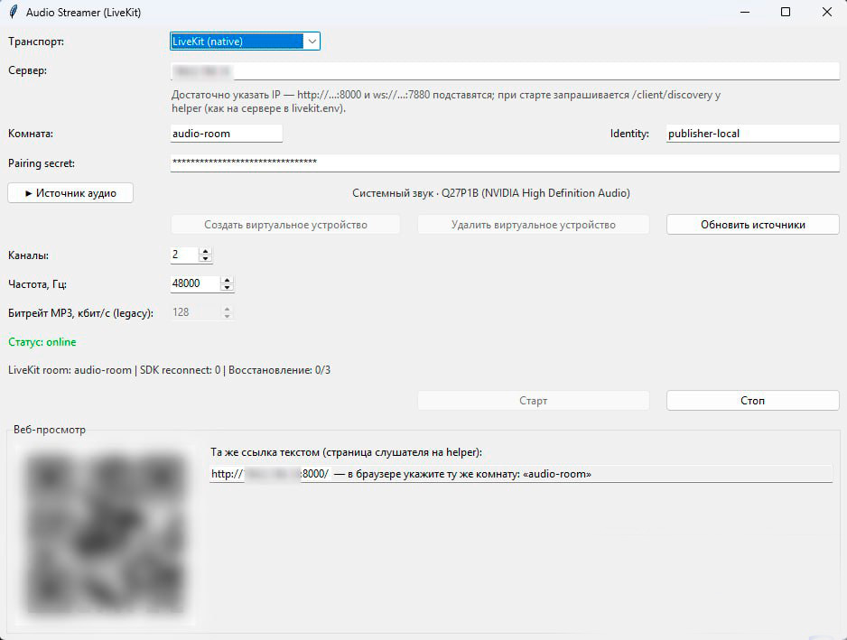
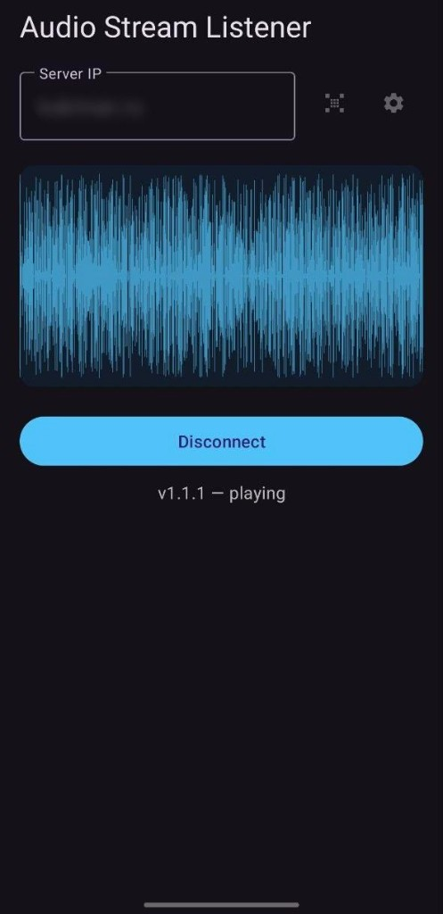

# Audio Streaming (LiveKit)

**EN:** Self-hosted low-latency audio streaming over [LiveKit](https://livekit.io/). Stack: Python helper + Tkinter publisher, Docker (LiveKit / Redis / coturn), Kotlin Android listener. Quick start: [Server](#развёртывание-сервера) · [Desktop client](#десктоп-клиент-publisher) · [APK build](#сборка-android-apk).

---

Аудиостриминг в реальном времени: десктопный publisher публикует звук в LiveKit, слушатели подключаются через браузер или Android-приложение. Helper-сервис выдаёт JWT-токены и отдаёт встроенный web-viewer.

## Скриншоты

**Desktop publisher** — `gui_client.py` (Windows / Linux):



**Android listener** — мобильное приложение:



## Компоненты

| Компонент | Файл / путь | Назначение |
|-----------|-------------|------------|
| Helper + web-viewer | `server.py` | Выдача токенов, discovery, страница прослушивания в браузере |
| Desktop publisher | `gui_client.py` | Захват микрофона / loopback, публикация в LiveKit |
| Инфраструктура | `deploy/livekit/` | LiveKit SFU, Redis, coturn (Docker Compose) |
| Android listener | `android/app/` | Подписка на аудио, QR-подключение, фоновое воспроизведение |
| Настройка | `setup_livekit.py` | Генерация секретов и первичная конфигурация |

Подробнее: [docs/architecture.md](docs/architecture.md)

## Технический стек

| Слой | Технологии |
|------|------------|
| **Python** | 3.9+, aiohttp, livekit / livekit-api, sounddevice, soundcard (Windows loopback), Tkinter |
| **Инфраструктура** | Docker Compose, LiveKit Server, Redis 7, coturn 4.6 |
| **Android** | Kotlin, Gradle 8.7, AGP 8.5, LiveKit Android 2.26, CameraX, ML Kit (QR), Twilio AudioSwitch |

## Требования

- **Сервер:** Python 3.9+, Docker и Docker Compose
- **Desktop publisher:** те же Python-зависимости; на Linux — `portaudio19-dev`, `ffmpeg` (опционально для legacy-транспорта)
- **Сборка APK:** Docker Desktop **или** локальный Android SDK (API 36, JDK 17)

## Быстрый старт

```bash
# 1. Первичная настройка: генерирует секреты в livekit.env (единственное место их хранения),
#    создаёт livekit.yaml / turnserver.conf без секретов.
#    --public-host — IP или домен, по которому клиенты достучатся до сервера; -y — без вопросов.
python3 setup_livekit.py -y --public-host YOUR_PUBLIC_IP

# 2. LiveKit (Docker) + helper-сервер. Скрипт сам создаст .venv и поставит зависимости;
#    если пользователь не в группе docker — использует sudo docker.
./start_server.sh

# 3. Publisher на той же или другой машине (pip install -r requirements.txt)
python gui_client.py
```

На Windows для шага 3 см. [развёртывание сервера](#развёртывание-сервера).

## Развёртывание сервера

### Linux / macOS / WSL

```bash
./start_server.sh
```

Скрипт создаёт `.venv`, при первом запуске вызывает `setup_livekit.py`, поднимает Docker Compose и запускает `server.py` на `HELPER_HOST:HELPER_PORT` (по умолчанию `0.0.0.0:8000`).

Ручная настройка конфигов (без `setup_livekit.py`):

```bash
cp livekit.env.example livekit.env
cp deploy/livekit/livekit.yaml.example deploy/livekit/livekit.yaml
cp deploy/livekit/turnserver.conf.example deploy/livekit/turnserver.conf
# Заполните секреты и публичные URL в livekit.env, затем:
docker compose --env-file livekit.env -f deploy/livekit/docker-compose.yml up -d
python server.py --host 0.0.0.0 --port 8000
```

### Windows (без bash)

```powershell
python -m venv .venv
.\.venv\Scripts\activate
pip install -r requirements.txt
python setup_livekit.py --public-host YOUR_PUBLIC_IP
docker compose --env-file livekit.env -f deploy/livekit/docker-compose.yml up -d
python server.py --host 0.0.0.0 --port 8000
```

### Порты (открыть в firewall)

| Порт | Протокол | Сервис |
|------|----------|--------|
| 8000 | TCP | Helper (`server.py`) |
| 7880 | TCP | LiveKit signaling (WebSocket) |
| 7881 | TCP | LiveKit RTC TCP |
| 7882 | UDP | LiveKit media (один мультиплексированный порт, `rtc.udp_port`) |
| 3478, 5349 | UDP/TCP | coturn (TURN, опционально) |
| 50000–60000 | UDP | coturn relay (только если используется TURN) |

Для удалённых клиентов в `livekit.env` задайте публичный IP или домен:

```env
LIVEKIT_URL=ws://YOUR_HOST:7880
HELPER_URL=http://YOUR_HOST:8000
```

Подробная конфигурация: [docs/configuration.md](docs/configuration.md)

## Десктоп-клиент (publisher)

```bash
python gui_client.py
```

1. Укажите адрес helper-сервера (IP или `http://host:8000`).
2. Выберите входное устройство (микрофон, loopback на Windows).
3. Нажмите «Начать стрим».

Клиент автоматически читает `livekit.env` / `.env`. Publisher-токен запрашивается у helper по `LIVEKIT_PAIRING_SECRET` — секрет LiveKit API в GUI вводить не нужно.

## Сборка Android APK

### Docker (без локального Android SDK)

```powershell
# Windows
cd android
.\build_docker.bat -Variant release
```

```bash
# Linux / macOS
cd android
./build_docker.sh --variant release
```

APK: `android/app/build/outputs/apk/release/app-release.apk`

### Локальный Gradle (если установлен SDK)

```bash
cd android
./gradlew assembleRelease
```

### Установка на устройство

```bash
adb install -r android/app/build/outputs/apk/release/app-release.apk
```

## Android listener

1. Установите APK на устройство (arm64-v8a).
2. Введите IP сервера или отсканируйте QR с URL helper (`http://host:port`).
3. Приложение запрашивает `/client/discovery`, получает токен и подключается к LiveKit.
4. Воспроизведение продолжается в фоне через foreground service.

## Конфигурация

Основной файл — `livekit.env` (шаблон: [livekit.env.example](livekit.env.example)):

| Переменная | Описание |
|------------|----------|
| `LIVEKIT_API_KEY` / `LIVEKIT_API_SECRET` | Ключи LiveKit (передаются в контейнер через docker-compose) |
| `LIVEKIT_PAIRING_SECRET` | Секрет для выдачи publisher-токена GUI-клиенту |
| `TURN_STATIC_AUTH_SECRET` | Shared secret coturn |
| `LIVEKIT_URL` | WebSocket URL LiveKit для клиентов |
| `HELPER_URL` | Публичный URL helper-сервера |
| `HELPER_HOST` / `HELPER_PORT` | Bind-адрес helper при запуске |

Полный справочник: [docs/configuration.md](docs/configuration.md)

## Советы по задержке и качеству

- Используйте UDP и рабочий TURN (coturn) для клиентов за NAT.
- Начинайте с 48 kHz, 1–2 канала.
- Для production задавайте длинные секреты (`LIVEKIT_API_SECRET` — 32+ байт).
- Все секреты хранятся только в `livekit.env`; после их смены перезапустите `./start_server.sh` (контейнеры пересоздадутся).
- Синхронизируйте время (NTP) на сервере и клиентах — JWT зависит от `exp` / `nbf`.

## Проверка

```bash
python performance_validation.py
```

Smoke-тест helper-сервиса (`/healthz`, `/livekit/token`). Внешний LiveKit SFU для теста не требуется.
