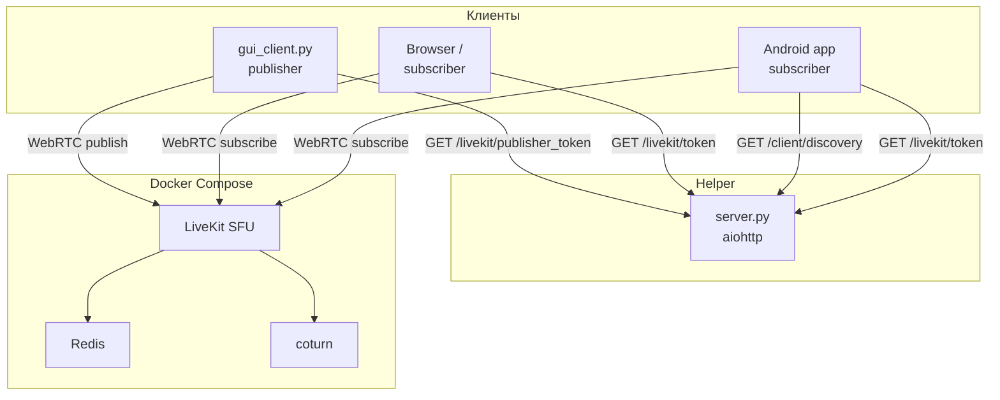

# Архитектура

## Обзор



## Роли

| Роль | Кто | Действие |
|------|-----|----------|
| **Publisher** | `gui_client.py` | Захватывает аудио, публикует трек в комнату LiveKit |
| **Subscriber** | Браузер, Android | Подписывается на аудиотрек publisher в той же комнате |
| **Helper** | `server.py` | Выдаёт JWT, discovery URL, встроенный web-viewer |
| **SFU** | LiveKit | Маршрутизация WebRTC-медиа между участниками |

Все клиенты в одной **room** (по умолчанию `audio-room`) с разными **identity**.

## Helper API

Базовый URL: `HELPER_URL` (по умолчанию `http://127.0.0.1:8000`).

| Метод | Путь | Назначение |
|-------|------|------------|
| GET | `/` | HTML-страница LiveKit Audio Viewer |
| GET | `/healthz` | `{"status": "ok"}` |
| GET | `/client/discovery` | Рекомендуемые URL для GUI/Android |
| GET | `/livekit/token` | JWT для subscriber (или publisher при `role=publisher`) |
| GET | `/livekit/publisher_token` | JWT для publisher (требует `pairing_secret`) |

### `/client/discovery`

Ответ:

```json
{
  "livekit_url": "ws://host:7880",
  "helper_url": "http://host:8000",
  "default_room": "audio-room"
}
```

Android и GUI используют этот endpoint, чтобы не хардкодить порты.

### `/livekit/token`

Query-параметры:

| Параметр | По умолчанию | Описание |
|----------|--------------|----------|
| `room` | `audio-room` | Имя комнаты LiveKit |
| `identity` | `viewer` | Идентификатор участника |
| `role` | `viewer` | `viewer` — только subscribe; `publisher` — publish + subscribe |

Пример:

```
GET /livekit/token?room=audio-room&identity=android-viewer
```

### `/livekit/publisher_token`

Защищённый endpoint для desktop publisher. Требует совпадения `pairing_secret` с `LIVEKIT_PAIRING_SECRET` на сервере.

```
GET /livekit/publisher_token?room=audio-room&identity=publisher-local&pairing_secret=...
```

При неверном секрете — HTTP 403.

## Поток подключения publisher

1. `gui_client.py` обращается к helper (`HELPER_URL` или поле «Сервер»).
2. Запрашивает `/livekit/publisher_token` с `LIVEKIT_PAIRING_SECRET` из env.
3. Получает JWT и подключается к `LIVEKIT_URL` через LiveKit Python SDK.
4. Публикует аудиотрек в указанную room.

## Поток подключения subscriber (Android)

1. Пользователь вводит IP или сканирует QR (`http://host:helper_port`).
2. `HelperApi` вызывает `/client/discovery` для получения `livekit_url` и `default_room`.
3. Запрашивает `/livekit/token?identity=android-viewer`.
4. `PlaybackService` подключается к LiveKit и воспроизводит аудио в фоне.

## Поток подключения subscriber (браузер)

1. Открыть `http://helper:8000/`.
2. Указать LiveKit WS URL, room, identity.
3. Страница запрашивает токен и подключается через LiveKit JS SDK.

## Ключевые файлы

| Файл | Описание |
|------|----------|
| `livekit_client.py` | LiveKit publish-логика для GUI |
| `livekit_token.py` | CLI-утилита генерации JWT |
| `audio_devices.py` | Перечисление входных устройств (Linux/Windows) |
| `env_loader.py` | Загрузка `livekit.env` / `.env` |
| `deploy/livekit/docker-compose.yml` | Redis + LiveKit + coturn |
| `android/.../PlaybackService.kt` | Фоновое воспроизведение на Android |
| `android/.../HelperApi.kt` | HTTP-запросы к helper |

## Проверка

```bash
python performance_validation.py
```

Локальный smoke-тест: поднимает `server.py` на порту 18000, проверяет `/healthz` и 20 вызовов `/livekit/token`, замеряет дрейф RSS. Внешний LiveKit SFU не требуется.
